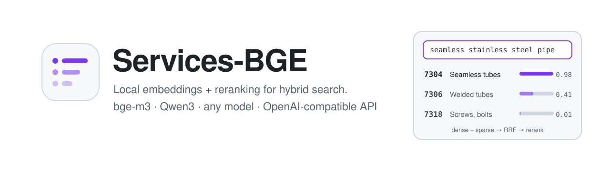
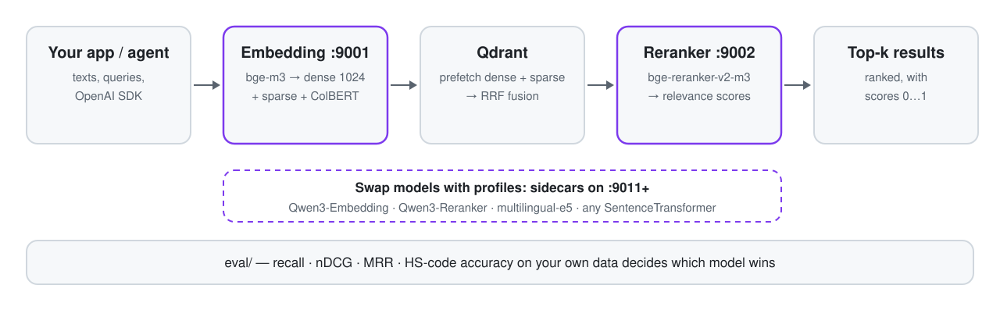
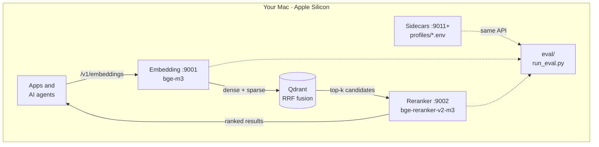

<p align="center">
  <picture>
    <source media="(prefers-color-scheme: dark)" srcset="docs/assets/banner-dark.svg">
    
  </picture>
</p>

<p align="center">
  <a href="https://github.com/FUYOH666/Services-BGE/releases/latest"></a>
  <a href="https://github.com/FUYOH666/Services-BGE/actions/workflows/test.yml"></a>
  
  
  
  <a href="LICENSE"></a>
</p>

<p align="center">
  <a href="#quick-start">Quick start</a> ·
  <a href="#features">Features</a> ·
  <a href="#models">Models</a> ·
  <a href="#compare-models-on-your-data">Compare models</a> ·
  <a href="#for-ai-agents">For AI agents</a> ·
  <a href="#how-it-works">How it works</a> ·
  <a href="#faq">FAQ</a> ·
  <a href="README.ru.md">Русский</a>
</p>

**Run your own embedding and reranking API on a Mac, and prove which model is best for your data.** Services-BGE serves [BAAI/bge-m3](https://huggingface.co/BAAI/bge-m3) (dense + sparse + ColBERT vectors in one pass) and [bge-reranker-v2-m3](https://huggingface.co/BAAI/bge-reranker-v2-m3) as two local services for hybrid search in [Qdrant](https://qdrant.tech). Any other model — Qwen3-Embedding, Qwen3-Reranker, multilingual-e5 or any SentenceTransformer — runs next to them from a one-file profile, and a built-in eval harness scores them all on your own queries. An [MCP server](docs/AGENT-MEMORY.md) turns the same stack into shared long-term memory for AI agents.

<p align="center">
  <picture>
    <source media="(prefers-color-scheme: dark)" srcset="docs/assets/how-it-works-dark.svg">
    
  </picture>
</p>

## Why

Retrieval quality decides what a RAG system, a search box or a classifier can ever find. Public leaderboards (MTEB and friends) rank models on generic web data; your domain — customs codes, part numbers, legal clauses, medical terms — behaves differently. A model that is #1 on a leaderboard can lose to an older one on your queries, and a reranker can make results *worse*.

Services-BGE gives you three things in one repository:

1. **A production-ready hybrid retriever** on Apple Silicon: bge-m3 is still one of the strongest permissive models for multilingual and Russian retrieval, and it returns dense, sparse and multi-vector outputs from a single forward pass.
2. **Model switching without code**: a profile file selects the backend, model, prompts and port; a challenger starts next to production with one command.
3. **Evidence**: the eval harness measures recall, nDCG, MRR, code accuracy and latency for every combination, so model changes are decisions, not guesses.

It was built for classifying product descriptions into customs (HS / ТН ВЭД) codes and now serves several RAG projects; nothing in it is specific to customs.

## Quick start

Apple Silicon Mac, Python 3.12 and [uv](https://docs.astral.sh/uv/):

```bash
git clone https://github.com/FUYOH666/Services-BGE.git && cd Services-BGE
uv sync
cp .env.example .env                  # optional: host, ports, limits, API key
./scripts/service.sh install          # launchd agents: start at login, restart on crash
./scripts/service.sh start
./scripts/service.sh status           # ready=True after ~30 s (first run downloads ~8.5 GB)
```

```bash
curl http://127.0.0.1:9001/v1/embeddings -H 'Content-Type: application/json' \
  -d '{"input": "seamless stainless steel pipe"}'

curl http://127.0.0.1:9002/v1/rerank -H 'Content-Type: application/json' \
  -d '{"query": "seamless stainless steel pipe", "documents": ["7304 Seamless tubes", "7318 Screws, bolts"]}'
```

`stop`, `restart`, `logs`, `rotate-logs` and `uninstall` do what they say. For a foreground run without launchd: `./scripts/start_all.sh`.

## Features

- **Hybrid vectors in one call.** Dense 1024-d, sparse lexical weights already shaped for Qdrant (`sparse_qdrant`), and optional ColBERT multi-vectors.
- **OpenAI-compatible.** `/v1/embeddings` works with the official `openai` SDK (string or list input, `encoding_format=base64`, `dimensions`, real `usage`); `/v1/rerank` follows the Cohere/Jina shape.
- **Pluggable models.** Backends for bge-m3, any SentenceTransformer (with query/document prompts and Matryoshka sizes), FlagEmbedding and sentence-transformers cross-encoders, and Qwen3-Reranker with its official yes/no scoring.
- **Memory for AI agents.** An MCP server (stdio or HTTP on :9003) lets Claude Code, Cursor, OpenClaw, Hermes and other agents `remember` notes and markdown folders and `search` them with hybrid retrieval + reranking, in your local Qdrant.
- **Sidecars for experiments.** `./scripts/sidecar.sh up <profile>` runs a challenger on its own port without touching production.
- **Eval built in.** Dense, sparse, hybrid RRF and reranked runs; recall, nDCG, MRR, HS-code prefix accuracy, latency; one comparison table across runs.
- **Safe defaults.** Loopback-only by default, optional API key, request limits, warm-up before ready, offline start from the local model cache.
- **Proven compatibility.** Contract tests pin the response fields existing clients use; `parity_check.py` compares two deployments down to the last float.
- **Runs itself.** `launchd` starts both services at login and restarts them on failure; logs rotate on demand.

## Models

Profiles live in [`profiles/`](profiles/). Production runs `bge-m3` + `bge-reranker-v2-m3` on 9001/9002; everything else is a sidecar on 9011+.

| Profile | Model | Backend | Output | Licence | Status |
|---|---|---|---|---|---|
| `bge-m3` | [BAAI/bge-m3](https://huggingface.co/BAAI/bge-m3) | `bge-m3` | dense 1024 + sparse + ColBERT | MIT | production |
| `bge-reranker-v2-m3` | [BAAI/bge-reranker-v2-m3](https://huggingface.co/BAAI/bge-reranker-v2-m3) | `flag-reranker` | relevance score | Apache-2.0 | production |
| `qwen3-embedding-0.6b` | [Qwen/Qwen3-Embedding-0.6B](https://huggingface.co/Qwen/Qwen3-Embedding-0.6B) | `sentence-transformers` | dense 1024, Matryoshka | Apache-2.0 | verified |
| `multilingual-e5-large` | [intfloat/multilingual-e5-large](https://huggingface.co/intfloat/multilingual-e5-large) | `sentence-transformers` | dense 1024 | MIT | verified |
| `qwen3-reranker-0.6b` | [Qwen/Qwen3-Reranker-0.6B](https://huggingface.co/Qwen/Qwen3-Reranker-0.6B) | `qwen3-reranker` | relevance score, instruction | Apache-2.0 | verified |
| `qwen3-reranker-4b` | [Qwen/Qwen3-Reranker-4B](https://huggingface.co/Qwen/Qwen3-Reranker-4B) | `qwen3-reranker` | relevance score, instruction | Apache-2.0 | candidate |

*Verified* = loaded and scored on an M4 Max through this repository. Adding a model is a new `.env` file; see [docs/MODELS.md](docs/MODELS.md) for backends, prompts, memory and the 2026 model landscape.

## Compare models on your data

```bash
./scripts/sidecar.sh up qwen3-embedding-0.6b qwen3-reranker-0.6b

# control: production bge-m3 + bge-reranker
uv run python eval/run_eval.py --dataset eval/datasets/demo_ru --name control
# challenger reranker on top of production retrieval
uv run python eval/run_eval.py --dataset eval/datasets/demo_ru --rerank-url http://127.0.0.1:9012 --name qwen3-rerank
# challenger dense model, still fused with bge-m3 sparse
uv run python eval/run_eval.py --dataset eval/datasets/demo_ru --embed-url http://127.0.0.1:9011 \
  --sparse-url http://127.0.0.1:9001 --name qwen3-embed

uv run python eval/compare.py eval/results/*.json --metric recall@1
./scripts/sidecar.sh down all
```

On the bundled demo set (36 Russian product descriptions → HS headings, M4 Max, fp32) the matrix in [`eval/results/COMPARISON.md`](eval/results/COMPARISON.md) shows:

| Retrieval | Reranker | recall@1 | nDCG@10 | Rerank latency (20 docs) |
|---|---|---|---|---|
| bge-m3 dense | Qwen3-Reranker-0.6B | **0.861** | **0.940** | ~580 ms |
| bge-m3 dense | — | 0.806 | 0.906 | — |
| bge-m3 dense | bge-reranker-v2-m3 | 0.750 | 0.893 | ~150 ms |
| Qwen3-Embedding-0.6B dense | — | 0.694 | 0.867 | — |
| bge-m3 dense + sparse, equal-weight RRF | — | 0.556 | 0.715 | — |

It is a toy set — a pipeline check, not a verdict — but it already shows why measuring matters: here the default reranker *lowers* top-1 accuracy, naive hybrid fusion hurts, and a newer dense model does not beat bge-m3. Bring a held-out set from your domain ([format](eval/README.md)) before switching anything.

## API

| Endpoint | Purpose |
|---|---|
| `POST :9001/v1/embeddings` | Dense / sparse / ColBERT vectors; OpenAI request and response shape plus hybrid fields |
| `POST :9002/v1/rerank` | Scores and orders documents for a query (`top_n`, `return_documents`, `instruction`) |
| `GET /v1/models` | Served model, backend, capabilities, dimensions, limits |
| `GET /readyz`, `/livez` | Readiness (model loaded and warmed up) and liveness |
| MCP `:9003/mcp` or stdio | Agent tools: `remember`, `search`, `list_collections`, `list_sources`, `forget`, `rerank`, `embed` ([docs/AGENT-MEMORY.md](docs/AGENT-MEMORY.md)) |

Field reference, error codes, a complete Qdrant hybrid-search example and response samples: **[docs/API.md](docs/API.md)**. Every setting: [docs/CONFIGURATION.md](docs/CONFIGURATION.md).

## For AI agents

**Shared memory over MCP.** `services-bge-mcp` gives Claude Code, Cursor, OpenClaw, Hermes or any MCP client long-term memory on top of these services: `remember` notes, decisions or a folder of markdown, `search` it with bge-m3 dense + sparse retrieval fused in Qdrant and reranked, `forget` by source. One collection can be shared by all your agents; nothing leaves the Mac.

```bash
uv run python scripts/mcp_smoke.py                                    # remember → search → forget on a scratch collection
claude mcp add --scope user services-bge -- "$(pwd)/scripts/mcp.sh"   # Claude Code; Cursor, OpenClaw, Hermes: see the guide
```

Per-agent setup, the tools, collection rules and safety: **[docs/AGENT-MEMORY.md](docs/AGENT-MEMORY.md)**.

**Raw APIs.** Both services listen on `127.0.0.1` and speak protocols agents already know. The official OpenAI SDK works unchanged:

```python
from openai import OpenAI

client = OpenAI(base_url="http://127.0.0.1:9001/v1", api_key="local")
vectors = client.embeddings.create(model="BAAI/bge-m3", input=["seamless stainless steel pipe"])
print(len(vectors.data[0].embedding))  # 1024
```

```python
import httpx

ranked = httpx.post("http://127.0.0.1:9002/v1/rerank", json={
    "query": "seamless stainless steel pipe",
    "documents": ["7304 Seamless tubes", "7306 Welded tubes", "7318 Screws, bolts"],
    "top_n": 1,
}).json()["results"]
```

`GET /v1/models` tells an agent what the running model can do. For coding agents working on this repository: [AGENTS.md](AGENTS.md) and [llms.txt](llms.txt).

## How it works



- **Two FastAPI services**, one model each, on PyTorch MPS. A per-process lock serializes inference on the GPU; heavy calls run off the event loop.
- **Backends** wrap the model library behind one interface (`embedding_service/backends.py`, `reranker_service/backends.py`), so the HTTP contract never changes when the model does.
- **launchd, not Docker**: containers on macOS cannot reach the Apple GPU through Metal, so the services run natively. Docker remains the right home for Qdrant and for Linux/CUDA deployments.
- **Why not TEI, Ollama or llama.cpp?** They serve bge-m3 dense vectors well, but as of November 2026 none returns bge-m3 sparse weights and ColBERT vectors on Metal. Sidecars can still point the eval at any of them.

## Performance

M4 Max, MPS, fp32, warm, median ([`scripts/parity_check.py`](scripts/parity_check.py)):

| Operation | Latency |
|---|---|
| bge-m3, 8 short texts, dense + sparse | 55–65 ms |
| bge-m3, 8 texts × ~450 tokens, dense + sparse | ~530 ms |
| bge-m3, 1 query, dense | ~30 ms |
| bge-reranker-v2-m3, 8 / 32 pairs | ~80 / ~215 ms |
| Qwen3-Reranker-0.6B, 20 pairs | ~580 ms |

Memory: ~3.7 GB per production service (≈7.4 GB for both). Response size for 16 mixed texts: 708 KB by default, 353 KB with `compact`, 99 KB with `compact` + `base64`. fp16 saves 0.6–1.2 GB per process with near-identical vectors but is not faster on torch 2.13 / M4, so fp32 stays the default ([measurements](docs/ROADMAP.md)).

## FAQ

<details>
<summary><b>Does any data leave my Mac?</b></summary>

No. Services bind to `127.0.0.1` by default, run models locally and send no telemetry. The network is used only to download models from Hugging Face the first time; afterwards the services start in offline mode from the local cache.
</details>

<details>
<summary><b>Can I use it from another machine or over Tailscale?</b></summary>

Yes: set `EMBEDDING_HOST=0.0.0.0` / `RERANKER_HOST=0.0.0.0` and a `SERVICE_API_KEY` in `.env`, then `./scripts/service.sh restart`. Clients send `Authorization: Bearer <key>` or `X-API-Key: <key>`.
</details>

<details>
<summary><b>Will an update break my existing clients?</b></summary>

The default responses are pinned by contract tests (`tests/test_service_endpoints.py`), and new options are opt-in. Before deploying a branch you can run it on side ports and compare it with production using `scripts/parity_check.py`.
</details>

<details>
<summary><b>How do I try a model that has no profile yet?</b></summary>

Copy the closest file in `profiles/`, change the model id, backend, prompts and port, then `./scripts/sidecar.sh up <name>`. [docs/MODELS.md](docs/MODELS.md) explains each backend and what to check.
</details>

<details>
<summary><b>Linux, Windows or NVIDIA GPUs?</b></summary>

The code is plain PyTorch, so `*_DEVICE=cuda` or `cpu` works, but the supervision scripts target macOS `launchd` and the project is tested on Apple Silicon. A Linux/CUDA container setup is on the [roadmap](docs/ROADMAP.md).
</details>

<details>
<summary><b>Memory keeps growing on MPS</b></summary>

By default the MPS cache is emptied after every request, which keeps memory flat. If you set `*_MPS_CACHE_THRESHOLD_MB`, the cache is emptied only above that threshold. Logs live in `~/Library/Logs/Services-BGE/`; see [docs/OPERATIONS.md](docs/OPERATIONS.md).
</details>

## Roadmap

The retrieval A/B plan, the November 2026 model landscape (licences, quantization rules, fp16 measurements) and the gate a challenger must pass to replace production: [docs/ROADMAP.md](docs/ROADMAP.md). Next up: the held-out HS-code evaluation, Qwen3-Reranker-4B, micro-batching across concurrent clients, Prometheus metrics and a Linux/CUDA compose file.

## For teams

Services-BGE is free and open source; run it yourself. If you want retrieval tuned for your documents — evaluation on your data, model selection, Qdrant pipelines, integration with your agents — write to [private@scanovich.ai](mailto:private@scanovich.ai) or Telegram [@ScanovichAI](https://t.me/ScanovichAI).

## Contributing

Issues and pull requests are welcome: [CONTRIBUTING.md](CONTRIBUTING.md). Security reports: [SECURITY.md](SECURITY.md). Changes: [CHANGELOG.md](CHANGELOG.md). If you use the eval harness or results in research, see [CITATION.cff](CITATION.cff).

## Acknowledgments

[BGE-M3 and bge-reranker](https://github.com/FlagOpen/FlagEmbedding) by BAAI · [Qwen3 Embedding and Reranker](https://github.com/QwenLM/Qwen3-Embedding) by the Qwen team · [multilingual-e5](https://huggingface.co/intfloat/multilingual-e5-large) by Microsoft · [sentence-transformers](https://www.sbert.net) · [PyTorch](https://pytorch.org) · [FastAPI](https://fastapi.tiangolo.com) · [Qdrant](https://qdrant.tech) · [uv](https://github.com/astral-sh/uv).

MIT License · maintained by [Aleksandr Mordvinov](https://github.com/FUYOH666) ([AUTHORS.md](AUTHORS.md)).
