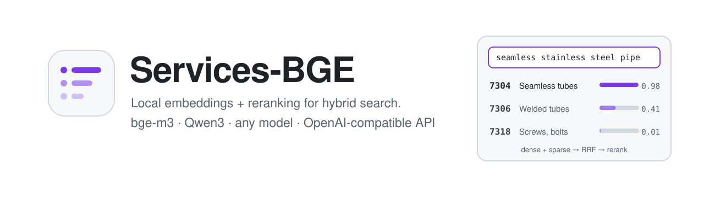
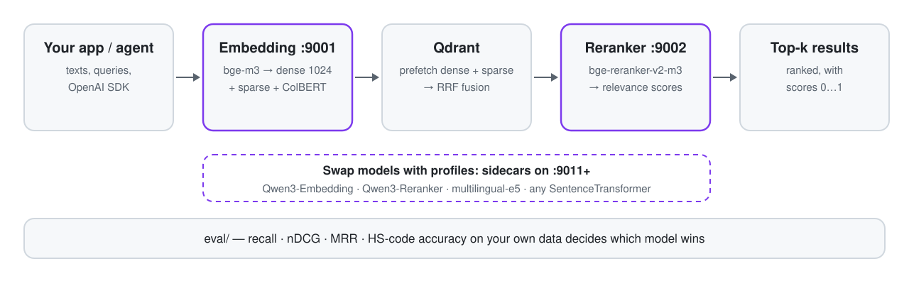

<p align="center">
  <picture>
    <source media="(prefers-color-scheme: dark)" srcset="docs/assets/banner-dark.svg">
    
  </picture>
</p>

<p align="center">
  <a href="https://github.com/FUYOH666/Services-BGE/releases/latest"></a>
  <a href="https://github.com/FUYOH666/Services-BGE/actions/workflows/test.yml"></a>
  
  
  <a href="LICENSE"></a>
</p>

<p align="center">
  <a href="#быстрый-старт">Быстрый старт</a> ·
  <a href="#возможности">Возможности</a> ·
  <a href="#модели">Модели</a> ·
  <a href="#сравнение-моделей-на-своих-данных">Сравнение моделей</a> ·
  <a href="#для-ai-агентов">Для AI-агентов</a> ·
  <a href="#как-это-устроено">Как устроено</a> ·
  <a href="README.md">English</a>
</p>

**Свой API эмбеддингов и реранкинга на Mac — и доказательство, какая модель лучше именно на ваших данных.** Services-BGE запускает [BAAI/bge-m3](https://huggingface.co/BAAI/bge-m3) (dense + sparse + ColBERT за один проход) и [bge-reranker-v2-m3](https://huggingface.co/BAAI/bge-reranker-v2-m3) как два локальных сервиса для гибридного поиска в [Qdrant](https://qdrant.tech). Любая другая модель — Qwen3-Embedding, Qwen3-Reranker, multilingual-e5 или любой SentenceTransformer — поднимается рядом из файла-профиля, а встроенный eval-харнесс сравнивает их на ваших запросах. [MCP-сервер](docs/AGENT-MEMORY.md) превращает тот же стек в общую долговременную память для AI-агентов.

<p align="center">
  <picture>
    <source media="(prefers-color-scheme: dark)" srcset="docs/assets/how-it-works-dark.svg">
    
  </picture>
</p>

## Зачем

Качество поиска определяет, что вообще сможет найти RAG-система, поисковая строка или классификатор. Публичные рейтинги (MTEB и другие) меряют модели на общих веб-данных, а ваш домен — коды ТН ВЭД, артикулы, ГОСТы, юридические формулировки — ведёт себя иначе. Модель №1 в рейтинге может проиграть старой на ваших запросах, а реранкер — сделать выдачу хуже.

Services-BGE даёт три вещи в одном репозитории:

1. **Готовый гибридный ретривер** на Apple Silicon. bge-m3 по-прежнему одна из сильнейших открытых моделей для мультиязычного и русского поиска и отдаёт dense, sparse и multi-vector за один проход.
2. **Переключение моделей без кода**: файл-профиль задаёт бэкенд, модель, промпты и порт; претендент запускается рядом с продом одной командой.
3. **Доказательства**: eval считает recall, nDCG, MRR, точность кода и латентность для любой комбинации — смена модели становится решением, а не догадкой.

Проект сделан для классификации описаний товаров в коды ТН ВЭД и сейчас обслуживает несколько RAG-проектов; ничего таможенного в нём не зашито.

## Быстрый старт

Mac на Apple Silicon, Python 3.12 и [uv](https://docs.astral.sh/uv/):

```bash
git clone https://github.com/FUYOH666/Services-BGE.git && cd Services-BGE
uv sync
cp .env.example .env                  # по желанию: хост, порты, лимиты, API-ключ
./scripts/service.sh install          # агенты launchd: старт при входе, перезапуск при падении
./scripts/service.sh start
./scripts/service.sh status           # ready=True через ~30 с (первый запуск скачает ~8.5 ГБ)
```

```bash
curl http://127.0.0.1:9001/v1/embeddings -H 'Content-Type: application/json' \
  -d '{"input": "бесшовные трубы из нержавеющей стали"}'

curl http://127.0.0.1:9002/v1/rerank -H 'Content-Type: application/json' \
  -d '{"query": "бесшовные трубы из нержавеющей стали", "documents": ["7304 — Трубы бесшовные", "7318 — Винты, болты"]}'
```

Команды `stop`, `restart`, `logs`, `rotate-logs`, `uninstall` делают то, что написано. Запуск без launchd: `./scripts/start_all.sh`.

## Возможности

- **Гибридные векторы одним вызовом.** Dense 1024, sparse-веса сразу в формате Qdrant (`sparse_qdrant`), по желанию ColBERT.
- **Совместимость с OpenAI.** `/v1/embeddings` работает с официальным SDK `openai` (строка или список, `encoding_format=base64`, `dimensions`, реальный `usage`); `/v1/rerank` в формате Cohere/Jina.
- **Подключаемые модели.** Бэкенды для bge-m3, любого SentenceTransformer (промпты запроса/документа, Matryoshka), кросс-энкодеров FlagEmbedding и sentence-transformers, а также Qwen3-Reranker с официальной yes/no-оценкой.
- **Память для AI-агентов.** MCP-сервер (stdio или HTTP на :9003): Claude Code, Cursor, OpenClaw, Hermes и другие агенты сохраняют заметки и папки markdown через `remember` и находят их через `search` — гибридный поиск с реранком в вашем локальном Qdrant.
- **Сайдкары для экспериментов.** `./scripts/sidecar.sh up <профиль>` поднимает претендента на своём порту, не трогая прод.
- **Встроенный eval.** Dense, sparse, гибрид RRF и реранк; recall, nDCG, MRR, точность кода ТН ВЭД по префиксу, латентность; одна сводная таблица.
- **Безопасные умолчания.** Только `127.0.0.1`, опциональный API-ключ, лимиты запросов, прогрев до готовности, офлайн-старт из локального кэша.
- **Доказанная совместимость.** Контрактные тесты фиксируют поля, которые читают клиенты; `parity_check.py` сравнивает две версии до последнего знака.
- **Живёт сам.** `launchd` запускает сервисы при входе и перезапускает при сбое; логи ротируются командой.

## Модели

Профили лежат в [`profiles/`](profiles/). Прод — `bge-m3` + `bge-reranker-v2-m3` на 9001/9002, остальное — сайдкары на 9011+.

| Профиль | Модель | Бэкенд | Выход | Лицензия | Статус |
|---|---|---|---|---|---|
| `bge-m3` | BAAI/bge-m3 | `bge-m3` | dense 1024 + sparse + ColBERT | MIT | прод |
| `bge-reranker-v2-m3` | BAAI/bge-reranker-v2-m3 | `flag-reranker` | оценка релевантности | Apache-2.0 | прод |
| `qwen3-embedding-0.6b` | Qwen/Qwen3-Embedding-0.6B | `sentence-transformers` | dense 1024, Matryoshka | Apache-2.0 | проверена |
| `multilingual-e5-large` | intfloat/multilingual-e5-large | `sentence-transformers` | dense 1024 | MIT | проверена |
| `qwen3-reranker-0.6b` | Qwen/Qwen3-Reranker-0.6B | `qwen3-reranker` | оценка, инструкция | Apache-2.0 | проверена |
| `qwen3-reranker-4b` | Qwen/Qwen3-Reranker-4B | `qwen3-reranker` | оценка, инструкция | Apache-2.0 | кандидат |

*Проверена* — загружена и протестирована на M4 Max через этот репозиторий. Новая модель — это новый `.env`-файл; подробности о бэкендах, промптах, памяти и обзор моделей 2026 года — в [docs/MODELS.md](docs/MODELS.md).

## Сравнение моделей на своих данных

```bash
./scripts/sidecar.sh up qwen3-embedding-0.6b qwen3-reranker-0.6b

uv run python eval/run_eval.py --dataset eval/datasets/demo_ru --name control
uv run python eval/run_eval.py --dataset eval/datasets/demo_ru --rerank-url http://127.0.0.1:9012 --name qwen3-rerank
uv run python eval/run_eval.py --dataset eval/datasets/demo_ru --embed-url http://127.0.0.1:9011 \
  --sparse-url http://127.0.0.1:9001 --name qwen3-embed

uv run python eval/compare.py eval/results/*.json --metric recall@1
./scripts/sidecar.sh down all
```

На демо-наборе (36 описаний товаров → товарные позиции ТН ВЭД, M4 Max, fp32) — полная таблица в [`eval/results/COMPARISON.md`](eval/results/COMPARISON.md):

| Поиск | Реранкер | recall@1 | nDCG@10 | Реранк, 20 документов |
|---|---|---|---|---|
| bge-m3 dense | Qwen3-Reranker-0.6B | **0.861** | **0.940** | ~580 мс |
| bge-m3 dense | — | 0.806 | 0.906 | — |
| bge-m3 dense | bge-reranker-v2-m3 | 0.750 | 0.893 | ~150 мс |
| Qwen3-Embedding-0.6B dense | — | 0.694 | 0.867 | — |
| bge-m3 dense + sparse, RRF с равными весами | — | 0.556 | 0.715 | — |

Это игрушечный набор — проверка конвейера, а не вердикт. Но он уже показывает, зачем мерить: здесь штатный реранкер *снижает* точность top-1, наивный гибрид вредит, а более новая dense-модель не обгоняет bge-m3. Прежде чем что-то менять, соберите отложенную выборку из своего домена ([формат](eval/README.md)).

## API

| Эндпоинт | Назначение |
|---|---|
| `POST :9001/v1/embeddings` | Dense / sparse / ColBERT; формат запроса и ответа OpenAI плюс гибридные поля |
| `POST :9002/v1/rerank` | Оценка и сортировка документов (`top_n`, `return_documents`, `instruction`) |
| `GET /v1/models` | Модель, бэкенд, возможности, размерность, лимиты |
| `GET /readyz`, `/livez` | Готовность (модель загружена и прогрета) и жизнь процесса |
| MCP `:9003/mcp` или stdio | Инструменты агентов: `remember`, `search`, `memory_status`, `list_collections`, `list_sources`, `forget`, `rerank`, `embed` ([docs/AGENT-MEMORY.md](docs/AGENT-MEMORY.md)) |

Все поля, коды ошибок, пример гибридного поиска в Qdrant: **[docs/API.md](docs/API.md)**. Все настройки: [docs/CONFIGURATION.md](docs/CONFIGURATION.md). Эксплуатация: [docs/OPERATIONS.md](docs/OPERATIONS.md).

## Для AI-агентов

**Общая память через MCP.** `services-bge-mcp` даёт Claude Code, Cursor, OpenClaw, Hermes и любому MCP-клиенту долговременную память поверх этих сервисов: `remember` сохраняет заметки, решения или папку markdown, `search` ищет по ним (bge-m3 dense + sparse, слияние в Qdrant и реранк), `forget` удаляет по источнику. Одну коллекцию могут делить все ваши агенты; данные не покидают Mac.

```bash
uv run python scripts/mcp_smoke.py                                    # remember → search → forget на временной коллекции
claude mcp add --scope user services-bge -- "$(pwd)/scripts/mcp.sh"   # Claude Code; Cursor, OpenClaw, Hermes — в руководстве
```

Подключение каждого агента, инструменты, правила коллекций и безопасность: **[docs/AGENT-MEMORY.md](docs/AGENT-MEMORY.md)** (на английском). `uv run services-bge-mcp sync` индексирует общий канон команды из git (только чтение), `uv run services-bge-mcp status` показывает, что лежит в памяти; если сервисы недоступны, поиск переходит на поиск по словам в файлах канона. Подключение только добавляет одну запись `services-bge` в настройки агента; как отключить и откатить: [docs/AGENT-ROLLBACK.md](docs/AGENT-ROLLBACK.md).

Необязательные **уровни доверия** помечают проверенные файлы как `canon`, а любую запись агента как `inbox`, чтобы ошибочная заметка одного бота не перебивала проверенный факт для следующего агента. Насколько хорошо память находит факты по вопросам на русском, английском и вперемешку, по сравнению с grep, и как часто подброшенная ложная заметка выходит первой с уровнями и без: **[docs/MEMORY-BENCH.md](docs/MEMORY-BENCH.md)** (на английском).

**Прямые API.** Сервисы слушают `127.0.0.1` и говорят на протоколах, которые агенты уже знают. Официальный OpenAI SDK работает без изменений:

```python
from openai import OpenAI

client = OpenAI(base_url="http://127.0.0.1:9001/v1", api_key="local")
vectors = client.embeddings.create(model="BAAI/bge-m3", input=["бесшовные трубы"])
print(len(vectors.data[0].embedding))  # 1024
```

`GET /v1/models` сообщает агенту, что умеет запущенная модель. Для агентов, которые работают с кодом репозитория: [AGENTS.md](AGENTS.md) и [llms.txt](llms.txt).

## Как это устроено

- **Два FastAPI-сервиса**, по одной модели, на PyTorch MPS. Блокировка на процесс сериализует инференс на GPU; тяжёлые вызовы идут вне event loop.
- **Бэкенды** прячут библиотеку модели за единым интерфейсом, поэтому HTTP-контракт не меняется, когда меняется модель.
- **launchd, а не Docker**: контейнеры на macOS не видят GPU Apple через Metal, поэтому сервисы работают нативно. Docker остаётся для Qdrant и Linux/CUDA.
- **Почему не TEI, Ollama или llama.cpp?** Dense-векторы bge-m3 они отдают хорошо, но на ноябрь 2026 ни один не отдаёт sparse и ColBERT bge-m3 на Metal. Через сайдкары eval можно направить и на них.

Память: ~3.7 ГБ на прод-сервис (≈7.4 ГБ на оба). Задержки и замеры fp16 — в [README](README.md#performance) и [docs/ROADMAP.md](docs/ROADMAP.md).

## Для команд

Services-BGE бесплатен и открыт — разворачивайте сами. Если нужен поиск, настроенный под ваши документы — оценка на ваших данных, подбор моделей, пайплайны Qdrant, интеграция с агентами — пишите на [private@scanovich.ai](mailto:private@scanovich.ai) или в Telegram [@ScanovichAI](https://t.me/ScanovichAI).

## Участие

Issues и pull requests приветствуются: [CONTRIBUTING.md](CONTRIBUTING.md). Уязвимости: [SECURITY.md](SECURITY.md). Изменения: [CHANGELOG.md](CHANGELOG.md). Цитирование: [CITATION.cff](CITATION.cff).

Лицензия MIT · автор [Александр Мордвинов](https://github.com/FUYOH666) ([AUTHORS.md](AUTHORS.md)).
