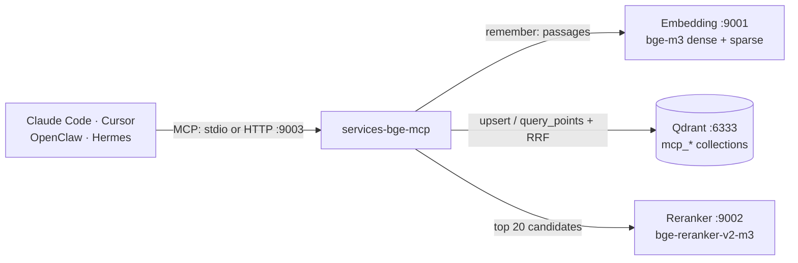

# Agent memory (MCP server)

`services-bge-mcp` turns the local embedding and reranking services into **shared long-term memory and search for AI agents**. Any agent that speaks the [Model Context Protocol](https://modelcontextprotocol.io) — Claude Code, Cursor, OpenClaw, Hermes, your own — can save notes, decisions and documents, and find them again later, from any project. Everything stays on your Mac.

Unlike the official Qdrant MCP server, which embeds with its own small FastEmbed model, this server uses the production stack: bge-m3 dense + sparse vectors fused in Qdrant, then bge-reranker-v2-m3. That is the same hybrid search the rest of this repository measures, and it handles Russian, English and mixed text, codes and part numbers.

- [How it works](#how-it-works)
- [Quick start](#quick-start)
- [Connect an agent](#connect-an-agent): [Claude Code](#claude-code) · [Cursor](#cursor) · [OpenClaw](#openclaw) · [Hermes](#hermes) · [Any agent over HTTP](#any-agent-over-http)
- [Tools](#tools)
- [Collections, sources and updates](#collections-sources-and-updates)
- [What is in the memory and why](#what-is-in-the-memory-and-why)
- [Sync the team canon](#sync-the-team-canon)
- [When a service is down](#when-a-service-is-down)
- [Trust tiers: curated canon vs unreviewed notes](#trust-tiers-curated-canon-vs-unreviewed-notes)
- [Protocol for agents (proposal)](#protocol-for-agents-proposal)
- [Cloud option (not built)](#cloud-option-not-built)
- [Safety](#safety)
- [Troubleshooting](#troubleshooting)
- [Disconnect and roll back](AGENT-ROLLBACK.md)

## How it works



1. **remember** splits text (or `.md`/`.txt` files) into passages of about 500 tokens with a small overlap, keeping the markdown heading path of each passage, embeds them with `input_type: "document"` and stores them in Qdrant.
2. **search** embeds the query, asks Qdrant for the best dense and sparse matches, fuses them with Reciprocal Rank Fusion, reranks the top 20 with the cross-encoder and returns the best passages with their `source`.

The server itself loads no model and uses almost no memory; it needs the two services and Qdrant to be running.

## Quick start

You need the services from the [README quick start](../README.md#quick-start) and a running [Qdrant](https://qdrant.tech/documentation/quickstart/) (tested with 1.18):

```bash
./scripts/service.sh status            # embedding and reranker: ready=True
curl -s http://127.0.0.1:6333/          # Qdrant answers with its version
```

If Qdrant is not running yet:

```bash
docker run -d --name qdrant --restart unless-stopped -p 127.0.0.1:6333:6333 \
  -v "$HOME/qdrant_storage:/qdrant/storage" qdrant/qdrant
```

Then check the whole loop on a scratch collection (it is deleted at the end):

```bash
uv sync
uv run python scripts/mcp_smoke.py      # PASS = remember, search, rerank and forget all work
```

Agents start the server themselves through `scripts/mcp.sh` (stdio). Run it as an HTTP server only for agents that prefer a URL:

```bash
./scripts/run_service.sh mcp            # http://127.0.0.1:9003/mcp, Ctrl+C to stop
```

## Connect an agent

Each snippet adds exactly one server entry, `services-bge`, and changes nothing else in the agent's setup. Back up the config file first; [AGENT-ROLLBACK.md](AGENT-ROLLBACK.md) shows how to remove the entry or restore the backup.

The snippets use `/absolute/path/to/Services-BGE`: run `pwd` in the repository folder and paste the result. `scripts/mcp.sh` needs no arguments and finds `uv` even when the agent is a desktop app. After adding the server, restart or reload the agent and ask it: *"List your services-bge memory collections."*

Indexing a large folder can take minutes (about 0.5 s per 8 passages); the snippets raise the agents' tool-call timeouts where they have one.

### Claude Code

```bash
# from the Services-BGE folder; --scope user makes it available in every project
claude mcp add --scope user services-bge -- "$(pwd)/scripts/mcp.sh"
claude mcp list
```

Over HTTP instead (with `./scripts/run_service.sh mcp` running):

```bash
claude mcp add --scope user --transport http services-bge http://127.0.0.1:9003/mcp
```

For long folder imports start Claude Code with `MCP_TOOL_TIMEOUT=600000` (milliseconds).

### Cursor

`~/.cursor/mcp.json` (all projects) or `.cursor/mcp.json` (one project) — add the entry inside the existing `mcpServers` object:

```json
{
  "mcpServers": {
    "services-bge": {
      "command": "/absolute/path/to/Services-BGE/scripts/mcp.sh"
    }
  }
}
```

Over HTTP: `"services-bge": {"url": "http://127.0.0.1:9003/mcp"}`. Then check in Cursor's MCP settings that the server is enabled and shows its tools.

### OpenClaw

```bash
openclaw mcp add services-bge --command "/absolute/path/to/Services-BGE/scripts/mcp.sh" --timeout 600
openclaw mcp reload
```

Over HTTP: `openclaw mcp add services-bge --url http://127.0.0.1:9003/mcp --transport streamable-http --timeout 600`. `openclaw mcp probe` lists the tools it sees. This is separate from OpenClaw's own memory embedder setting, which can keep pointing at `http://127.0.0.1:9001/v1`.

### Hermes

`~/.hermes/config.yaml`, under `mcp_servers:`:

```yaml
mcp_servers:
  services-bge:
    command: /absolute/path/to/Services-BGE/scripts/mcp.sh
    timeout: 600          # seconds per tool call
```

Over HTTP: replace `command:` with `url: http://127.0.0.1:9003/mcp`.

### Any agent over HTTP

| Setting | Value |
|---|---|
| Transport | Streamable HTTP (stateless, JSON-RPC over POST) |
| URL | `http://127.0.0.1:9003/mcp` |
| Health | `GET http://127.0.0.1:9003/healthz` |
| Auth | none on loopback; with `MCP_API_KEY` set: `Authorization: Bearer <key>` or `X-API-Key: <key>` |

Over stdio, any MCP client can run `scripts/mcp.sh`, or `uv run --directory /absolute/path/to/Services-BGE services-bge-mcp`. For the [MCP Inspector](https://github.com/modelcontextprotocol/inspector): `npx @modelcontextprotocol/inspector /absolute/path/to/Services-BGE/scripts/mcp.sh`.

## Tools

| Tool | What it does | Changes data |
|---|---|---|
| `remember(texts \| path, collection?, source?, tags?, replace?)` | Saves notes (`texts`, one string each) or a `.md`/`.markdown`/`.mdx`/`.txt`/`.rst` file or folder (`path`) | adds / updates |
| `search(query, collection?, top_k=5, rerank=true, tags?, source?, min_score?, tiers?, prefer_tier?)` | Hybrid search + rerank; returns `text`, `source`, `score`, `section`, `tags`, `created_at`, `tier` | no |
| `memory_status()` | What is indexed (team canon: repository, commit, files by tier; every collection with its sources) and the current mode: full, no-rerank, degraded or down. `summary` says it in plain words | no |
| `list_collections()` | Collections with passage counts and the embedding model that built them | no |
| `list_sources(collection?, limit=100)` | Sources in a collection with passage counts | no |
| `forget(collection, source? \| everything=true)` | Deletes one source, or the whole collection | **deletes** |
| `rerank(query, documents, top_n?)` | Orders your own candidates with the cross-encoder | no |
| `embed(texts, input_type="document", sparse=false)` | Raw 1024-d bge-m3 vectors (≤ 8 texts) for agents building their own index | no |

Results are JSON (MCP structured output). Example `search` result:

```json
{
  "collection": "memory",
  "query": "which port is the reranker on",
  "reranked": true,
  "results": [
    {"text": "Services-BGE serves bge-m3 embeddings on port 9001 and the bge-reranker-v2-m3 reranker on port 9002.",
     "source": "smoke-notes", "score": 0.9774, "chunk": 0, "tags": ["smoke"], "created_at": "2026-11-11T10:46:56+00:00"}
  ]
}
```

With `rerank=true` the score is the reranker's 0–1 relevance; below about 0.1 a passage is rarely useful (`min_score` drops them). With `rerank=false` it is the RRF fusion score, useful only for ordering. If the reranker is down, search still answers in fusion order and says so in `note`.

## Collections, sources and updates

- **Collection** = namespace. The default is `memory`; agents that use the same name share memory. In Qdrant each one is stored as `mcp_<name>` with a named dense vector `dense` (1024, cosine), a sparse vector `sparse` (bge-m3 lexical weights) and payload `text`, `source`, `chunk`, `section`, `tags`, `created_at`, `hash` (and `tier` when [trust tiers](#trust-tiers-curated-canon-vs-unreviewed-notes) are on). The embedding model is recorded in the collection metadata.
- **Source** = where a passage came from: the file path (`~/notes/plan.md`), or what you pass as `source` (`meeting-2026-11-11`, a URL). Notes saved without a source get `note:<id>`. `forget(collection, source=...)` deletes exactly that source.
- **Files** are documents: remembering a file again re-embeds only the passages that changed and removes passages the file no longer has. Files deleted from disk stay in memory until you `forget` their source.
- **Notes** accumulate: the same text saved twice is stored once, different texts under one `source` are all kept. `replace=true` makes the source contain exactly the new texts.
- **Point ids** are UUIDv5 of source + passage number (+ content hash for notes), so repeated calls are idempotent.

## What is in the memory and why

Memory holds two kinds of text, and `memory_status` (or `uv run services-bge-mcp status` in a terminal) lists both, with their sources and passage counts.

| What | Where | Tier | Who writes it |
|---|---|---|---|
| **The team canon**: the files every agent is told to read first (`CANON.md`, `STATE.md`, `ORG.md`, `AGENTS.md`, `repos.md`), the decision records (`decisions/`) and one card per project (`projects/`) | collection `canon` | `canon` | only `services-bge-mcp sync`, from a read-only git clone; the commit is recorded |
| Open proposals in the canon repository's `inbox/` (frontmatter `status: proposed`) | collection `canon` | `inbox` | the same sync |
| Agents' own notes and the files they choose to save (`remember`) | the collection they name, `memory` by default | `inbox` once a canon is synced | any connected agent |

**Not indexed**, by design: inbox files the curator has closed (`status: curated`, `accepted` or `rejected`, since their content already lives in the canon or `decisions/`) and inbox files without a status, such as its README; personal agent memories (Hermes `SOUL` / `MEMORY.md`, OpenClaw `MEMORY.md`, Claude Code project memories), secrets, `.env` files, code repositories, and anything else on the Mac. Sync reads exactly the files listed above from the clone and nothing else. An agent can still save a note or a file with `remember`; that write is visible in `memory_status` under its source, as tier `inbox`.

**Why this shape.**

- **The canon is what every agent must agree on.** It is small and curated, and git stays its source of truth. The index is a copy that sync rebuilds from git.
- **Searching it is cheaper than reading it.** On the [memory bench](MEMORY-BENCH.md), five 150-token passages held the answer to 92% of questions. That is about 1,500 characters, against 15,500 for the five read-first files, which answered 50%.
- **Agents' notes stay separate and labelled.** A wrong note cannot pose as canon, because its tier comes from where it was written, not from what it claims.

## Sync the team canon

One command clones the canon repository (or fast-forwards an existing clone) and brings the `canon` collection in line with it:

```bash
# first time: where the canon lives and where to keep the clone
uv run services-bge-mcp sync --repo your-org/memory --dir ~/development/memory
# afterwards (repo and folder are remembered)
uv run services-bge-mcp sync
uv run services-bge-mcp status
```

- **Read-only.** It runs `gh repo clone` or `git clone`, then `git pull --ff-only`, and never commits or pushes. A clone with local changes is not pulled; it is indexed as it is, with a warning.
- **Idempotent.** Only changed passages are embedded again. Passages of files that were deleted, renamed or closed by the curator are removed. Agents' notes in the collection are left alone.
- **Only open proposals from the inbox.** An inbox file is indexed while its frontmatter says `status: proposed` (`MCP_CANON_INBOX_STATUSES`). `status` and the sync output say which files were skipped and why, e.g. "6 curated inbox files skipped: already in canon or decisions/".
- **Short passages.** Canon files are cut into passages of about 150 tokens (`MCP_CANON_CHUNK_TOKENS`). On the bench this gave the same recall as 500 tokens, with a third of the rerank time (0.6 s instead of 1.9 s).
- **Recorded.** `~/.services-bge/canon-sync.json` holds the repository, commit, time and every file with its tier and passage count. The server reads this record: it knows which files are canon, ranks them first in the `canon` collection, and tells agents in its instructions where the canon is.
- **When to run it.** Run it after the canon changes, by hand or from your own scheduler. Running it twice in a row changes nothing.

Which files count as canon is set by `MCP_CANON_FILES` and `MCP_CANON_INBOX`; all settings are in [CONFIGURATION.md](CONFIGURATION.md#mcp-server-mcp_).

### Keep it fresh automatically

The canon changes through pull requests; the index should follow without anyone remembering to sync. One opt-in launchd agent does that:

```bash
./scripts/service.sh memory-sync on       # pull + re-index at login and every 30 minutes
./scripts/service.sh memory-sync status   # on/off, last exit code, what is indexed
./scripts/service.sh memory-sync now      # one sync right now
./scripts/service.sh memory-sync off      # stop; the index keeps its last state
```

A run only reads the canon clone (fast-forward pull) and re-embeds the passages that changed, so a quiet canon costs a few seconds. If the services or Qdrant are down, the run fails and the next one retries; agents keep searching the last good index, or fall back to keyword search. Log: `~/Library/Logs/Services-BGE/memory-sync.log`.

## When a service is down

Agents keep working without memory; memory just tells them how much it can help.

| Mode (`memory_status`) | When | What `search` does |
|---|---|---|
| `full` | embedding service, reranker and Qdrant are up | hybrid search + rerank |
| `no-rerank` | the reranker is down | hybrid search in fusion order, with a `note` |
| `degraded` | the embedding service or Qdrant is down (Mac asleep, Docker stopped, model loading) | **keyword search over the canon files on disk**, marked `degraded: true`. The `note` says what is down and which `CANON.md` to read directly. Agents' saved notes cannot be searched until the service is back |
| `down` | the same, and no canon has been synced | an error that says what is down; agents read the canon from git as before |

The degraded results come only from curated files. Unreviewed notes are never served without the services that label them.


When several agents share one collection, any of them can write something wrong, by mistake or because a prompt injection told it to, and the next agent will find it. Trust tiers keep curated facts on top. They are off by default; nothing changes until you set `MCP_CANON_PATHS` or [sync a team canon](#sync-the-team-canon), whose files count as canon too.

```bash
# .env — files that went through review (here: a local clone of a canon repository)
MCP_CANON_PATHS=~/memory/CANON.md:~/memory/STATE.md:~/memory/decisions
MCP_PREFER_TIER=canon        # optional: every search ranks canon first
```

- **The tier follows where the text came from; the writer cannot choose it.** Passages read from files inside `MCP_CANON_PATHS` are stored as `tier: "canon"`. Everything else — every note saved with `texts`, every other file — is `tier: "inbox"` (unreviewed). `remember` has no tier argument, and a note that *claims* to be approved is still an inbox note.
- **`search` shows the tier** of each passage next to its `source`, and the server tells agents to trust `canon` when the two disagree.
- **`prefer_tier="canon"`** (or `MCP_PREFER_TIER=canon` for every call) ranks canon first when relevance is close: scores of passages from other tiers are multiplied by `MCP_TIER_PENALTY` (0.5). Search also fetches the best canon candidates separately, so a flood of near-identical notes cannot push the curated passage out of the candidate pool. Inbox passages are still returned; a clearly better inbox answer still wins.
- **`tiers=["canon"]`** returns curated passages only (quarantine). Safest, but facts that exist only as notes are then invisible.
- Turning tiers on later only relabels: remembering the canon files again sets their tier without re-embedding them.

How much this helps, measured: [MEMORY-BENCH.md](MEMORY-BENCH.md). The canon files themselves must be protected elsewhere (review, branch protection); an agent that can edit them on disk can still change canon.

## Protocol for agents (proposal)

A snippet the team's coordinator can add to the agents' shared instructions. It is a proposal, not something this repository changes:

> **Memory.** Before answering a question about the team, its rules, plans or decisions, search the `services-bge` MCP server with `collection="canon"`. Cite the `source` you used. If a result has `tier: "inbox"` and contradicts a `canon` result, trust canon and say there is a conflict. If the server is unavailable or the result says `degraded: true`, read `CANON.md` (and the file named in the result) from the git canon as before. Save new durable facts with `remember`. They are stored as unreviewed `inbox` notes; proposals for the canon itself still go through its own review process.

Agents that cannot reach this Mac cannot use the MCP server. A bot running on its provider's servers, such as a Grok bot on xAI's servers, keeps reading the canon from GitHub directly. Nothing about that changes.

## Cloud option (not built)

The index could live in the cloud instead of on the Mac. Nothing in this repository does that yet; this is what it would take and cost.

- **Embeddings.** OpenRouter has an OpenAI-compatible embeddings endpoint that serves `BAAI/bge-m3` (dense only) and `Qwen3-Embedding` models. `MCP_EMBEDDING_URL=https://openrouter.ai/api` would match the client's `/v1/embeddings` path, but requests would also need a `model` field and an OpenRouter key, which is a small code change.
- **Storage.** It needs a cloud Qdrant (`MCP_QDRANT_URL`, `MCP_QDRANT_API_KEY`) that agents off the Mac can reach.
- **Trade-offs:**
  - Every passage of the canon leaves the Mac, both for the embedding provider and for the cloud database.
  - There are no sparse vectors, so search is dense-only. On the bench, dense-only answered 60–79% of questions first, against 78–92% for hybrid + rerank.
  - The local reranker cannot be used from elsewhere.
  - Every call costs money and depends on the network.
- **Recommendation:** use it only for collections that are not confidential. The team canon is not one of them.

## Safety

- **Local only.** The HTTP server binds to `127.0.0.1` and checks the `Host` header against DNS rebinding. Binding to another address is refused unless `MCP_API_KEY` is set.
- **Other projects' collections are invisible.** The server only lists, searches and deletes collections with the `mcp_` prefix (`MCP_COLLECTION_PREFIX`), so an agent cannot read or drop `tnved` or any other collection of yours.
- **`forget` is permanent** and never runs without an explicit target: it needs `source=...` or `everything=true`. It is marked as destructive, so clients that ask before destructive tools will ask.
- **File reading is fenced.** `remember(path=...)` reads only files with the listed extensions, inside `MCP_ALLOWED_PATHS` (default: your home folder), skips hidden folders, `node_modules` and virtual environments when walking a folder, and stops at `MCP_MAX_FILE_BYTES` per file and `MCP_MAX_FILES` / `MCP_MAX_CHUNKS` per call. Symlinks pointing outside the allowed folders are skipped.
- **One model per collection.** If you switch the embedding service to another model, the server refuses to mix its vectors into a collection built with bge-m3 and says how to fix it. Dense-only models (Qwen3, e5) work in new collections, with dense search only.
- **No secrets in memory.** The server's instructions tell agents not to store passwords or keys; memory is plain text in Qdrant on your disk.
- Calls to the services send `SERVICE_API_KEY` (or `EMBEDDING_API_KEY` / `RERANKER_API_KEY`, or `MCP_EMBEDDING_API_KEY` / `MCP_RERANKER_API_KEY`) when set, read from the same `.env` as the services.

All settings: [CONFIGURATION.md](CONFIGURATION.md#mcp-server-mcp_).

## Troubleshooting

| Message | Fix |
|---|---|
| `The embedding service at http://127.0.0.1:9001 is not reachable` | `./scripts/service.sh status`, then `start`; or set `MCP_EMBEDDING_URL` |
| `… is still loading its model` | Wait ~30 s after a restart |
| `rejected the API key` | Put the services' key in `.env` as `SERVICE_API_KEY` (the MCP server reads the same file) |
| `Qdrant at http://127.0.0.1:6333 is not reachable` | Start Qdrant (`docker start qdrant`), or set `MCP_QDRANT_URL` |
| `Collection 'x' was built with BAAI/bge-m3, but the embedding service now runs …` | Switch 9001 back to bge-m3, or `forget(..., everything=true)` and remember again |
| `… is outside the folders this server may read` | Add the folder to `MCP_ALLOWED_PATHS` in `.env` (separate several with `:`) |
| Agent shows no tools / `uv: command not found` | Use the absolute path to `scripts/mcp.sh`. Run it in a terminal: it should wait silently for input (Ctrl+C to quit); an error there is the real cause |
| Long folder import times out | Raise the agent's tool timeout (see each agent above) or remember subfolders one at a time |

The server logs to stderr, which agents keep in their MCP logs (Claude Code: `claude --debug`; Hermes: `~/.hermes/logs`).
