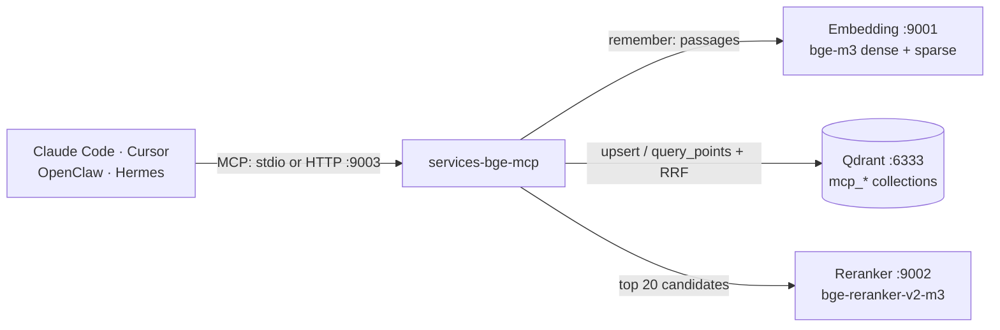

# Agent memory (MCP server)

`services-bge-mcp` turns the local embedding and reranking services into **shared long-term memory and search for AI agents**. Any agent that speaks the [Model Context Protocol](https://modelcontextprotocol.io) — Claude Code, Cursor, OpenClaw, Hermes, your own — can save notes, decisions and documents, and find them again later, from any project. Everything stays on your Mac.

Unlike the official Qdrant MCP server, which embeds with its own small FastEmbed model, this server uses the production stack: bge-m3 dense + sparse vectors fused in Qdrant, then bge-reranker-v2-m3. That is the same hybrid search the rest of this repository measures, and it handles Russian, English and mixed text, codes and part numbers.

- [How it works](#how-it-works)
- [Quick start](#quick-start)
- [Connect an agent](#connect-an-agent): [Claude Code](#claude-code) · [Cursor](#cursor) · [OpenClaw](#openclaw) · [Hermes](#hermes) · [Any agent over HTTP](#any-agent-over-http)
- [Tools](#tools)
- [Collections, sources and updates](#collections-sources-and-updates)
- [Safety](#safety)
- [Troubleshooting](#troubleshooting)

## How it works



1. **remember** splits text (or `.md`/`.txt` files) into passages of about 500 tokens with a small overlap, keeping the markdown heading path of each passage, embeds them with `input_type: "document"` and stores them in Qdrant.
2. **search** embeds the query, asks Qdrant for the best dense and sparse matches, fuses them with Reciprocal Rank Fusion, reranks the top 20 with the cross-encoder and returns the best passages with their `source`.

The server itself loads no model and uses almost no memory; it needs the two services and Qdrant to be running.

## Quick start

You need the services from the [README quick start](../README.md#quick-start) and a running [Qdrant](https://qdrant.tech/documentation/quickstart/) (tested with 1.18):

```bash
./scripts/service.sh status            # embedding and reranker: ready=True
curl -s http://127.0.0.1:6333/          # Qdrant answers with its version
```

If Qdrant is not running yet:

```bash
docker run -d --name qdrant --restart unless-stopped -p 127.0.0.1:6333:6333 \
  -v "$HOME/qdrant_storage:/qdrant/storage" qdrant/qdrant
```

Then check the whole loop on a scratch collection (it is deleted at the end):

```bash
uv sync
uv run python scripts/mcp_smoke.py      # PASS = remember, search, rerank and forget all work
```

Agents start the server themselves through `scripts/mcp.sh` (stdio). Run it as an HTTP server only for agents that prefer a URL:

```bash
./scripts/run_service.sh mcp            # http://127.0.0.1:9003/mcp, Ctrl+C to stop
```

## Connect an agent

The snippets use `/absolute/path/to/Services-BGE`: run `pwd` in the repository folder and paste the result. `scripts/mcp.sh` needs no arguments and finds `uv` even when the agent is a desktop app. After adding the server, restart or reload the agent and ask it: *"List your services-bge memory collections."*

Indexing a large folder can take minutes (about 0.5 s per 8 passages); the snippets raise the agents' tool-call timeouts where they have one.

### Claude Code

```bash
# from the Services-BGE folder; --scope user makes it available in every project
claude mcp add --scope user services-bge -- "$(pwd)/scripts/mcp.sh"
claude mcp list
```

Over HTTP instead (with `./scripts/run_service.sh mcp` running):

```bash
claude mcp add --scope user --transport http services-bge http://127.0.0.1:9003/mcp
```

For long folder imports start Claude Code with `MCP_TOOL_TIMEOUT=600000` (milliseconds).

### Cursor

`~/.cursor/mcp.json` (all projects) or `.cursor/mcp.json` (one project) — add the entry inside the existing `mcpServers` object:

```json
{
  "mcpServers": {
    "services-bge": {
      "command": "/absolute/path/to/Services-BGE/scripts/mcp.sh"
    }
  }
}
```

Over HTTP: `"services-bge": {"url": "http://127.0.0.1:9003/mcp"}`. Then check in Cursor's MCP settings that the server is enabled and shows its tools.

### OpenClaw

```bash
openclaw mcp add services-bge --command "/absolute/path/to/Services-BGE/scripts/mcp.sh" --timeout 600
openclaw mcp reload
```

Over HTTP: `openclaw mcp add services-bge --url http://127.0.0.1:9003/mcp --transport streamable-http --timeout 600`. `openclaw mcp probe` lists the tools it sees. This is separate from OpenClaw's own memory embedder setting, which can keep pointing at `http://127.0.0.1:9001/v1`.

### Hermes

`~/.hermes/config.yaml`, under `mcp_servers:`:

```yaml
mcp_servers:
  services-bge:
    command: /absolute/path/to/Services-BGE/scripts/mcp.sh
    timeout: 600          # seconds per tool call
```

Over HTTP: replace `command:` with `url: http://127.0.0.1:9003/mcp`.

### Any agent over HTTP

| Setting | Value |
|---|---|
| Transport | Streamable HTTP (stateless, JSON-RPC over POST) |
| URL | `http://127.0.0.1:9003/mcp` |
| Health | `GET http://127.0.0.1:9003/healthz` |
| Auth | none on loopback; with `MCP_API_KEY` set: `Authorization: Bearer <key>` or `X-API-Key: <key>` |

Over stdio, any MCP client can run `scripts/mcp.sh`, or `uv run --directory /absolute/path/to/Services-BGE services-bge-mcp`. For the [MCP Inspector](https://github.com/modelcontextprotocol/inspector): `npx @modelcontextprotocol/inspector /absolute/path/to/Services-BGE/scripts/mcp.sh`.

## Tools

| Tool | What it does | Changes data |
|---|---|---|
| `remember(texts \| path, collection?, source?, tags?, replace?)` | Saves notes (`texts`, one string each) or a `.md`/`.markdown`/`.mdx`/`.txt`/`.rst` file or folder (`path`) | adds / updates |
| `search(query, collection?, top_k=5, rerank=true, tags?, source?, min_score?)` | Hybrid search + rerank; returns `text`, `source`, `score`, `section`, `tags`, `created_at` | no |
| `list_collections()` | Collections with passage counts and the embedding model that built them | no |
| `list_sources(collection?, limit=100)` | Sources in a collection with passage counts | no |
| `forget(collection, source? \| everything=true)` | Deletes one source, or the whole collection | **deletes** |
| `rerank(query, documents, top_n?)` | Orders your own candidates with the cross-encoder | no |
| `embed(texts, input_type="document", sparse=false)` | Raw 1024-d bge-m3 vectors (≤ 8 texts) for agents building their own index | no |

Results are JSON (MCP structured output). Example `search` result:

```json
{
  "collection": "memory",
  "query": "which port is the reranker on",
  "reranked": true,
  "results": [
    {"text": "Services-BGE serves bge-m3 embeddings on port 9001 and the bge-reranker-v2-m3 reranker on port 9002.",
     "source": "smoke-notes", "score": 0.9774, "chunk": 0, "tags": ["smoke"], "created_at": "2026-11-11T10:46:56+00:00"}
  ]
}
```

With `rerank=true` the score is the reranker's 0–1 relevance; below about 0.1 a passage is rarely useful (`min_score` drops them). With `rerank=false` it is the RRF fusion score, useful only for ordering. If the reranker is down, search still answers in fusion order and says so in `note`.

## Collections, sources and updates

- **Collection** = namespace. The default is `memory`; agents that use the same name share memory. In Qdrant each one is stored as `mcp_<name>` with a named dense vector `dense` (1024, cosine), a sparse vector `sparse` (bge-m3 lexical weights) and payload `text`, `source`, `chunk`, `section`, `tags`, `created_at`, `hash`. The embedding model is recorded in the collection metadata.
- **Source** = where a passage came from: the file path (`~/notes/plan.md`), or what you pass as `source` (`meeting-2026-11-11`, a URL). Notes saved without a source get `note:<id>`. `forget(collection, source=...)` deletes exactly that source.
- **Files** are documents: remembering a file again re-embeds only the passages that changed and removes passages the file no longer has. Files deleted from disk stay in memory until you `forget` their source.
- **Notes** accumulate: the same text saved twice is stored once, different texts under one `source` are all kept. `replace=true` makes the source contain exactly the new texts.
- **Point ids** are UUIDv5 of source + passage number (+ content hash for notes), so repeated calls are idempotent.

## Safety

- **Local only.** The HTTP server binds to `127.0.0.1` and checks the `Host` header against DNS rebinding. Binding to another address is refused unless `MCP_API_KEY` is set.
- **Other projects' collections are invisible.** The server only lists, searches and deletes collections with the `mcp_` prefix (`MCP_COLLECTION_PREFIX`), so an agent cannot read or drop `tnved` or any other collection of yours.
- **`forget` is permanent** and never runs without an explicit target: it needs `source=...` or `everything=true`. It is marked as destructive, so clients that ask before destructive tools will ask.
- **File reading is fenced.** `remember(path=...)` reads only files with the listed extensions, inside `MCP_ALLOWED_PATHS` (default: your home folder), skips hidden folders, `node_modules` and virtual environments when walking a folder, and stops at `MCP_MAX_FILE_BYTES` per file and `MCP_MAX_FILES` / `MCP_MAX_CHUNKS` per call. Symlinks pointing outside the allowed folders are skipped.
- **One model per collection.** If you switch the embedding service to another model, the server refuses to mix its vectors into a collection built with bge-m3 and says how to fix it. Dense-only models (Qwen3, e5) work in new collections, with dense search only.
- **No secrets in memory.** The server's instructions tell agents not to store passwords or keys; memory is plain text in Qdrant on your disk.
- Calls to the services send `SERVICE_API_KEY` (or `EMBEDDING_API_KEY` / `RERANKER_API_KEY`, or `MCP_EMBEDDING_API_KEY` / `MCP_RERANKER_API_KEY`) when set, read from the same `.env` as the services.

All settings: [CONFIGURATION.md](CONFIGURATION.md#mcp-server-mcp_).

## Troubleshooting

| Message | Fix |
|---|---|
| `The embedding service at http://127.0.0.1:9001 is not reachable` | `./scripts/service.sh status`, then `start`; or set `MCP_EMBEDDING_URL` |
| `… is still loading its model` | Wait ~30 s after a restart |
| `rejected the API key` | Put the services' key in `.env` as `SERVICE_API_KEY` (the MCP server reads the same file) |
| `Qdrant at http://127.0.0.1:6333 is not reachable` | Start Qdrant (`docker start qdrant`), or set `MCP_QDRANT_URL` |
| `Collection 'x' was built with BAAI/bge-m3, but the embedding service now runs …` | Switch 9001 back to bge-m3, or `forget(..., everything=true)` and remember again |
| `… is outside the folders this server may read` | Add the folder to `MCP_ALLOWED_PATHS` in `.env` (separate several with `:`) |
| Agent shows no tools / `uv: command not found` | Use the absolute path to `scripts/mcp.sh`. Run it in a terminal: it should wait silently for input (Ctrl+C to quit); an error there is the real cause |
| Long folder import times out | Raise the agent's tool timeout (see each agent above) or remember subfolders one at a time |

The server logs to stderr, which agents keep in their MCP logs (Claude Code: `claude --debug`; Hermes: `~/.hermes/logs`).
